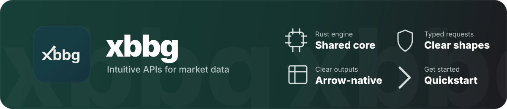

<!-- markdownlint-disable MD033 MD041 -->
<div align="center">

<a href="https://xbbg.org/">
  
</a>

[](https://central.sonatype.com/artifact/io.github.underloam/xbbg)
[](#install)
[](https://javadoc.io/doc/io.github.underloam/xbbg)
[](https://github.com/underloam/xbbg/releases)
[](https://github.com/underloam/xbbg/actions/workflows/ci-rust.yml)
[](https://discord.gg/P34uMwgCjC)

**Links:** [Documentation](https://xbbg.org/) · [Javadoc](https://javadoc.io/doc/io.github.underloam/xbbg) · [GitHub](https://github.com/underloam/xbbg) · [Changelog](https://github.com/underloam/xbbg/blob/main/CHANGELOG.md)

</div>

---

# xbbg for Java

Java bindings for [xbbg](../README.md): the same request, recipe, extension and subscription
functions as the Node package [`@xbbg/core`](../js-xbbg/README.md), running on the shared Rust
engine through JNI.

| Artifact | Java | What |
|---|---|---|
| `io.github.underloam:xbbg` | 8+ | The full API. Native libraries for Windows x64, Linux x64 (glibc 2.28+) and macOS arm64 are bundled in the jar; no runtime dependencies. |
| `io.github.underloam:xbbg-jdk17` | 17+ | Optional add-on: `Flow` publishers, sealed types for pattern matching, Arrow Java interop, virtual-thread callbacks. |

You still need Bloomberg access (a Terminal, B-PIPE or SAPI) and the Bloomberg runtime library,
which xbbg never bundles (see [the Bloomberg runtime](#the-bloomberg-runtime)).

## Install

Both artifacts are published to Maven Central with the xbbg releases that include them, so Maven,
Gradle, sbt, Bazel and any other Maven-repository client can resolve them.

```xml
<dependency>
  <groupId>io.github.underloam</groupId>
  <artifactId>xbbg</artifactId>
  <version><!-- xbbg release --></version>
</dependency>
```

```kotlin
dependencies {
    implementation("io.github.underloam:xbbg:<xbbg release>")
    implementation("io.github.underloam:xbbg-jdk17:<xbbg release>") // optional, Java 17+
}
```

On JDK 24 and later, start the JVM with `--enable-native-access=ALL-UNNAMED` (or the module
name, `io.github.underloam.xbbg`, on the module path) to avoid the native-access warning; later
JDKs will require it. A command line that must also start Java 8 or 11 can add
`-XX:+IgnoreUnrecognizedVMOptions`. The `Enable-Native-Access` manifest attribute only applies
when xbbg is inside the application jar started with `java -jar`.

## Quickstart

```java
import io.github.underloam.xbbg.BdhOptions;
import io.github.underloam.xbbg.Blp;
import io.github.underloam.xbbg.Xbbg;
import io.github.underloam.xbbg.table.Column;
import io.github.underloam.xbbg.table.Table;
import java.util.Arrays;

Table ref = Xbbg.await(Blp.bdp(Arrays.asList("AAPL US Equity", "MSFT US Equity"),
    Arrays.asList("PX_LAST", "SECURITY_NAME")));
for (int row = 0; row < ref.numRows(); row++) {
  System.out.println(ref.column("ticker").getString(row) + " "
      + ref.column("field").getString(row) + " = " + ref.column("value").get(row));
}

Table hist = Xbbg.await(Blp.bdh("SPX Index", "PX_LAST",
    BdhOptions.builder().start("2024-01-01").end("2024-12-31").build()));
Column date = hist.column("date");
System.out.println(date.getLocalDate(0) + " .. " + date.getLocalDate(hist.numRows() - 1));
```

- Every call that can reach Bloomberg returns a `CompletableFuture`. `Xbbg.await(future)`
  blocks for the result and rethrows the original exception instead of a `CompletionException`.
  Native code never blocks a Java thread, so waiting on virtual threads does not pin carriers.
- `Blp` holds the top-level functions of the JS package and runs them on a shared engine that
  connects on first use; `Xbbg.configure(...)` changes its settings first. `Engine` instances
  (`Engine.connect(config)`, or the blocking `Engine.open(config)`) expose the same methods plus
  the engine-level ones (field and schema caches, entitlements) and are `AutoCloseable`.
- Options are immutable builders named after the JS option objects (`BdpOptions`,
  `BdhOptions`, `BqlOptions`, `StreamOptions`, ...) with the same defaults. Date fields take
  ISO or Bloomberg `YYYYMMDD` text or a `java.time` value. `Overrides` builds Bloomberg overrides,
  including per-security ones.
- Names follow the JS API. The JS `a*` aliases (`abdp`, `abdh`, ...) are not repeated, and the
  positional dates and intervals of `abdh`/`abdib`/`abdtick` are option fields
  (`BdhOptions.start`/`end`, `BdibOptions.day`/`interval`, ...).

## Configuration and engines

```java
import io.github.underloam.xbbg.AuthConfig;
import io.github.underloam.xbbg.Engine;
import io.github.underloam.xbbg.EngineConfig;
import io.github.underloam.xbbg.KeyColumn;

EngineConfig config = EngineConfig.builder()
    .host("localhost")
    .port(8194)
    .keyColumn(KeyColumn.SECURITY)        // the default "ticker" is deprecated
    .auth(AuthConfig.user())
    .build();

Xbbg.configure(config);                   // the shared engine behind Blp.*

try (Engine engine = Engine.open(config)) {
  Table fields = Xbbg.await(engine.fieldInfo("PX_LAST"));
}
```

`EngineConfig` covers every JS engine setting: servers and failover, ZFP, SOCKS5, TLS (paths or
in-memory PKCS#12/PKCS#7 bytes), authentication (`user`, `app`, `userApp`, `directory`, `manual`,
`token`), worker and queue sizes, retries, timeouts, validation, the field cache and SDK logging.
`Engine.close()` ends the engine's sessions and its subscriptions; an engine that is collected
without `close()` is released only once its subscriptions and pending calls are done.
`Xbbg.setLogLevel(LogLevel.DEBUG)` changes native logging, and `XbbgWarnings.addListener(...)`
receives the warnings JS emits with `process.emitWarning` (same types and codes); without a
listener they go to `java.util.logging`.

## Results

Table-shaped results come back as a `Table` by default: Arrow buffers copied once into Java
arrays and decoded on access. `Column` has typed getters (`getDouble`, `getLong`, `getString`,
`getLocalDate`, `getInstant`, `getZonedDateTime`, ...), and `resultMetadata()` decodes Bloomberg
request ids, entitlement ids, delayed-data flags, security errors, field exceptions and field
errors. Pass a `Backend` for another shape:

```java
import io.github.underloam.xbbg.Backend;
import io.github.underloam.xbbg.table.RowsResult;

RowsResult rows = Xbbg.await(Blp.bdp("IBM US Equity", "PX_LAST", Backend.ROWS)); // List<Map<String, Object>>
byte[] ipc = Xbbg.await(Blp.bdp("IBM US Equity", "PX_LAST", Backend.IPC_STREAM)); // Arrow IPC stream
```

With `xbbg-jdk17`, `ArrowBackends.vectorSchemaRoot(allocator)` returns Arrow Java
`VectorSchemaRoot`s and `ArrowTables.toVectorSchemaRoot(table, allocator)` converts a `Table`.
Arrow Java needs `--add-opens=java.base/java.nio=org.apache.arrow.memory.core,ALL-UNNAMED` on
Java 17+.

## Subscriptions

```java
import io.github.underloam.xbbg.OverflowPolicy;
import io.github.underloam.xbbg.subscription.StreamOptions;
import io.github.underloam.xbbg.subscription.Subscription;
import io.github.underloam.xbbg.subscription.SubscriptionDelivery;
import io.github.underloam.xbbg.subscription.Tick;
import java.time.Duration;
import java.util.Optional;

try (Subscription sub = Xbbg.await(Blp.subscribe(Arrays.asList("AAPL US Equity", "MSFT US Equity"),
    Arrays.asList("LAST_PRICE", "BID", "ASK")))) {
  for (Tick tick : sub) {                      // or sub.next(Duration), sub.nextAsync()
    if (tick.has("LAST_PRICE")) {
      System.out.println(tick.topic() + " " + tick.get("LAST_PRICE"));
    }
  }
}

StreamOptions gapAware = StreamOptions.builder().overflowPolicy(OverflowPolicy.DROP_OLDEST).build();
try (Subscription sub = Xbbg.await(Blp.subscribe("AAPL US Equity", "LAST_PRICE", gapAware))) {
  Optional<SubscriptionDelivery<Table>> delivery = sub.deliveries().next(Duration.ofSeconds(30));
  delivery.flatMap(SubscriptionDelivery::gapBefore)
      .ifPresent(gap -> System.out.println("dropped " + gap.droppedUpdates() + " updates"));
}
```

- A subscription is read in one format: ticks (iterate the `Subscription`), Arrow tables
  (`arrow()`), or deliveries (`deliveries(backend)`, required for `drop_oldest` gaps and
  `delivery(SubscriptionDeliveryMode.STATE)` current-state images). `latest()` returns the
  current value of every field without consuming updates.
- `Tick.has(field)` tells an absent field from an explicit clear (`isNull`), as the JS
  `undefined`/`null` split does.
- `add`, `addFields` and `remove` change topics and fields on a live subscription; `stats()`,
  `status()`, `events()`, `failures()`, `topicStates()`, `sessionStatus()` and the other getters
  report its health. Cancelling a pending `nextAsync()` closes the subscription, like a JS abort.
- `stream`, `vwap`, `mktbar`, `depth`, `chains`, `subscribeWithOptions`, `subscribeAuction`,
  `streamAuction` and `subscribeEtfInav` are on `Blp` and `Engine` too.
- With `xbbg-jdk17`, `XbbgFlow.ticks(sub)`, `arrow(...)` and `deliveries(...)` return
  `java.util.concurrent.Flow` publishers, and `DeliveryView`, `TickValue` and `Errors.classify`
  give sealed types for exhaustive `switch` on Java 21.

## The Bloomberg runtime

xbbg loads the Bloomberg runtime library (`blpapi3_64.dll`, or `libblpapi3_64.so` on Linux and
macOS) before its own native library and never bundles it. The first match wins:

1. `Xbbg.setSdkPath(path)`, or the `xbbg.blpapi.path` system property (a directory or the file);
2. `BLPAPI_LIB_DIR`, `BLPAPI_ROOT`, `XBBG_DEV_SDK_ROOT`;
3. a Bloomberg Terminal install (`C:\blp\DAPI` and the other Terminal locations; `~/blp/DAPI`
   and `/opt/bloomberg/DAPI` elsewhere), then the Windows `PATH`;
4. a runtime xbbg provisioned earlier into its cache (`xbbg.cache.dir`, `XBBG_CACHE_DIR`, or the
   platform cache directory);
5. provisioning from a configured source.

Provisioning only happens when a source is configured, and only when nothing local was found. A
source is a Python package index, a conda channel, or one package file:

```java
import io.github.underloam.xbbg.sdk.BlpapiSource;

Xbbg.setSdkSource(BlpapiSource.pypi("https://blpapi.bloomberg.com/repository/releases/python/simple/"));
// or BlpapiSource.conda("https://conda.anaconda.org/conda-forge"), a corporate mirror of either,
// or BlpapiSource.artifact("https://.../blpapi-3.26.9.1-py3-none-win_amd64.whl#sha256=...")
```

The same sources work as text in `-Dxbbg.sdk.source=` or `XBBG_SDK_SOURCE`
(`pypi:<index url>`, `conda:<channel>`, `artifact:<url or path>`), with an optional version in
`xbbg.sdk.version`/`XBBG_SDK_VERSION`. xbbg downloads the wheel or conda package for this
platform, checks it against the index or repodata hash and the library against the package's
own file hashes, and installs it atomically into its cache with a provenance record. It uses the
operating system's trust store, the JVM's proxy settings (falling back to `HTTPS_PROXY` and the
OS settings), and credentials given in the URL, a netrc file or `ProvisionOptions`.
`BlpapiSdk.provision(options)` gives full control (version, platform, cache directory, offline
mode, proxy, per-host credentials, extra CA certificates), and the same code runs from the
command line, for example to prepare a Docker image or a server:

```bash
java -cp xbbg-<version>.jar io.github.underloam.xbbg.sdk.BlpapiSdk \
    --source conda:https://conda.anaconda.org/conda-forge --cache-dir /opt/xbbg-cache
```

Wheels older than 3.24.10 are refused: earlier wheels rename the library. Bloomberg's licence
terms apply to the runtime however it is obtained.

## Errors

Failures are unchecked `BlpException`s with the JS classes' names and fields:
`BlpSessionException`, `BlpRequestException` (service, operation, request id),
`BlpLimitException`, `BlpSubscriptionDataLossException` (topic, detail), `BlpValidationException`
(element, suggestion), `BlpTimeoutException` and `BlpInternalException`, each with the Bloomberg
support request ids. Caller mistakes are `IllegalArgumentException`/`IllegalStateException`, a
missing runtime is `BlpapiNotFoundException`, and cancellation is `CancellationException`.

## Build, test and release

This section covers building `io.github.underloam:xbbg` from source, testing it, checking a
built jar the way an application consumes it, and publishing it to Maven Central.

### Layout

| Path | What |
|---|---|
| `pom.xml` | Parent `io.github.underloam:xbbg-parent` (plugin versions, release profile). |
| `xbbg/` | `io.github.underloam:xbbg`: Java 8 bytecode, zero runtime dependencies, bundled JNI libraries. |
| `xbbg-jdk17/` | `io.github.underloam:xbbg-jdk17`: Java 17 add-on, no natives. |
| `natives/` | Staged JNI libraries (git-ignored), copied into the jar as `io/github/underloam/xbbg/native/<platform>/`. |
| `consumers/` | Maven and Gradle projects that consume a built jar (smoke tests, not modules of the build). |

The jar bundles two libraries per platform (`windows-x86_64`, `linux-x86_64`, `macos-aarch64`):
`xbbg_jni` (the engine; links the Bloomberg runtime, which is never bundled) and `xbbg_sdk_jni`
(Bloomberg runtime provisioning; never links it). Each platform directory also holds
`natives.properties`: the JNI ABI version, the SHA-256 of each library, and build provenance
(Rust target, Cargo profile and features, `testSupport`, git commit, rustc, Bloomberg headers).

### Prerequisites

- JDK 21 or newer to run Maven (Error Prone needs it; the jars still target Java 8 and 17). The Maven Wrapper (`./mvnw`, `mvnw.cmd`)
  downloads Maven itself. When scripting `mvnw.cmd`, close stdin (`< NUL`): it can hang when
  stdin is inherited from a non-console parent.
- For natives: the Rust toolchain and Bloomberg C++ SDK setup used for the other bindings (see
  `CONTRIBUTING.md`), and Python 3.9+ for `scripts/stage_jvm_natives.py`.

### Staging natives

Run from the repository root; each command builds both JNI crates for the host and replaces
`java-xbbg/natives/<platform>/`:

```bash
python scripts/stage_jvm_natives.py stage                          # debug build
python scripts/stage_jvm_natives.py stage --features test-support  # debug + test fixtures (native tests)
python scripts/stage_jvm_natives.py stage --release                # distributable build
```

`--release` builds the `release-jni` profile (release optimisation with `panic = "unwind"`, so a
Rust panic becomes a Java exception instead of aborting the JVM) with `--locked`, and refuses
test-support features, host-tuned code generation (a `target-cpu` other than the default, or
`target-feature`/`llvm-args` in `RUSTFLAGS`) and an unknown git commit. Every build is checked:
`xbbg_jni` must reference the Bloomberg runtime exactly once (`blpapi3_64.dll`,
`libblpapi3_64.so`, or on macOS `@rpath/libblpapi3_64.so` after the install names are rewritten
and the library re-signed), `xbbg_sdk_jni` must not reference it at all, test-support builds must
export the `NativeTestSupport` fixtures and other builds must not contain them, and on Linux the
libraries must not need glibc newer than 2.28 (fatal with `--release`; release builds run in the
manylinux_2_28 image). Only a `stage --release` that passed all of this records `release=true`
in `natives.properties`; a plain `--profile release-jni` stage is not releasable. Other options:
`--target <triple>`, `--out <dir>`, `--locked`, `--profile <name>`, `--features <list>`
(unqualified names belong to `jni-xbbg`).

`verify` re-checks staged natives or built jars, for example before packaging:

```bash
python scripts/stage_jvm_natives.py verify --release --natives java-xbbg/natives
python scripts/stage_jvm_natives.py verify --release --expect-version 1.2.3 \
    --natives java-xbbg/xbbg/target/xbbg-1.2.3.jar --scan java-xbbg/xbbg-jdk17/target/xbbg-jdk17-1.2.3.jar
```

It checks each library against its recorded SHA-256, rejects stray files, test-support fixtures in
release natives and any Bloomberg SDK file, and with `--expect-version` compares the version
recorded by the natives, the jar manifests and the stamped `xbbg.properties`. `--release` also
requires all three platforms and `stage --release` provenance (`release=true`, `portable=true`
and a git commit in every `natives.properties`); the `-Dxbbg.releaseNatives=true` / `-Prelease`
packaging guard likewise accepts only natives recording `release=true` and `portable=true`.
`--expect-commit <sha>` requires every native to have been built from that commit.

### Building and testing

From `java-xbbg/`:

```bash
./mvnw verify                                   # build, tests on the build JDK
./mvnw -Dtest.jdk=8 verify                      # module xbbg's tests on a Java 8 toolchain
./mvnw -Dxbbg.requireNatives=true verify        # native tests must run (fail instead of skip)
```

- `-Dtest.jdk=<v>` forks the tests on the JDK registered as version `<v>` in
  `~/.m2/toolchains.xml` (or `-t <file>`); `xbbg-jdk17` always tests on a 17+ toolchain.
  `actions/setup-java` registers major versions (`8`, `11`, ...).
- Native tests need staged natives (`stage --features test-support`) and the Bloomberg runtime
  (Terminal install, `BLPAPI_LIB_DIR`, `BLPAPI_ROOT`, ...). Without natives they skip;
  `-Dxbbg.requireNatives=true` also fails the build early when this host's natives are missing.
- `-Dxbbg.natives.dir=<dir>` reads natives from elsewhere; `-Dxbbg.target=<name>` changes the
  output directory name (parallel builds in one checkout).
- Live Bloomberg tests (`@Tag("live")`) are excluded; run them with
  `-Dxbbg.excludedGroups= -Dgroups=live`.
- Tests and both consumers pass `-XX:+IgnoreUnrecognizedVMOptions --enable-native-access=ALL-UNNAMED`:
  JDK 24+ warns about `System.load` without native access, and JDK 8 and 11 accept the flag only
  together with `IgnoreUnrecognizedVMOptions`. Applications should pass the same options (or
  `--enable-native-access=io.github.underloam.xbbg` on the module path).

`-Dxbbg.releaseNatives=true` (implied by `-Prelease`) builds a distributable jar: all three
platforms must be staged as release natives, every library must match its SHA-256, no library may
contain test-support fixtures, and nothing else may sit in the natives directory.

`io.github.underloam:xbbg` must keep zero runtime dependencies (enforced). Modules that use Arrow
Java (Java 11+ bytecode, so `xbbg-jdk17` only, as an optional dependency) get managed versions
from the parent (`arrow.version`) and add `${xbbg.arrowJvmArgs}` to their test `argLine`.

### Quality gates

`./mvnw verify` (and the `lint-java` CI job, with `-DskipTests`) enforces, in both modules:

- **Formatting**: google-java-format (Google style) for Java and ktfmt (Google style) for the
  consumer Gradle scripts, through Spotless, checked at `verify`. `./mvnw spotless:apply`
  formats everything; `-DspotlessFiles=<regex>` limits it to some files. The generated enums
  (`defs/codegen/generate.py`) are emitted already formatted, so `generate.py --check` and
  `spotless:check` agree.
- **javac lint**: `-Xlint:all` (minus the "source value 8 is obsolete" option warning).
- **Error Prone** with its default severities, as a javac plugin (`.mvn/jvm.config` holds the
  JDK exports it needs). Main and test code compile with `-Werror`, so javac lint and Error
  Prone warnings fail the build. `-Dxbbg.failOnWarning=false` lists every warning (and javadoc
  warning) without failing while you fix them, and `-Dxbbg.errorprone.flags=...` passes extra
  flags, e.g. `"-XepPatchChecks:OperatorPrecedence -XepPatchLocation:IN_PLACE"` to apply Error
  Prone's fixes.
- **Javadoc**: doclint with every group, `missing` included (each public and protected type and
  member is documented); doclint errors and javadoc warnings fail `package`.
- **SpotBugs** (`spotbugs:check` at `verify`, main code): effort `Max`, threshold `Low`; any
  finding fails the build. Findings that are correct by design are excluded in
  `spotbugs-exclude.xml`, each matched narrowly and with its reason. `-Dspotbugs.skip=true` skips
  it locally.
- **Maven Enforcer**: Maven 3.9+, a JDK 21+ build, every plugin version pinned (no
  SNAPSHOT/LATEST/RELEASE), no duplicate dependency declarations, `dependencyConvergence`,
  `requireUpperBoundDeps`, and no SNAPSHOT dependency in a stamped (release) build.
- **Coverage** (`-Pcoverage`): JaCoCo measures each module's own classes during its tests,
  writes `<module>/target/site/jacoco/`, and fails the build below the module's
  `xbbg.coverage.line` / `xbbg.coverage.branch` minimums (`xbbg` 63% / 57%, `xbbg-jdk17`
  88% / 86%), measured on JDK 21 with the native and subscription fixture tests:
  `XBBG_TEST_SUBSCRIPTIONS=1 ./mvnw -Pcoverage -Dxbbg.requireNatives=true verify`. CI enforces
  them in exactly one configuration, `java-test` on Windows with Java 21. The agent is only
  attached in this profile.

Suppressions are scoped to the smallest element and carry a comment with the reason; they cover
code that is correct by design (the public `java.util.Date` overloads, identity comparisons of
futures and exceptions, callbacks whose outcome is routed to another future).

### Consumer smoke tests

`consumers/maven` and `consumers/gradle` (Gradle 9, Kotlin DSL) resolve the jar from a file
repository like an application would, then run `consumers/src/consumer/Main.java`: it extracts
and loads the natives and prints `Xbbg.version()`, `Xbbg.nativeVersion()` and the Bloomberg
runtime version. With `consumer.blpapiArtifact` it first provisions the Bloomberg runtime from a
local wheel or conda package through `xbbg_sdk_jni` and loads that runtime.

```bash
# 1. publish the build to a file repository (no ~/.m2 install)
cd java-xbbg
# (Windows: use a file:///C:/... URL)
./mvnw -DskipTests -DaltDeploymentRepository=local::file://$PWD/target/consumer-repo deploy

# 2. a Bloomberg wheel for this platform (blpapi >= 3.24.10), as the provisioning source
python -m pip download --no-deps --only-binary=:all: --dest /tmp/blpapi \
    --index-url https://blpapi.bloomberg.com/repository/releases/python/simple/ blpapi

# 3. Maven: one JDK per run, from toolchains.xml
cd consumers/maven
./mvnw -Drun.jdk=8 -Dconsumer.blpapiArtifact=/tmp/blpapi/<wheel>.whl verify

# 4. Gradle: every runtime in xbbgRuntimes (default 8,11,17,21,25)
cd ../gradle
./gradlew -PblpapiArtifact=/tmp/blpapi/<wheel>.whl smoke
```

Both default to version `0.0.0-SNAPSHOT` in `java-xbbg/target/consumer-repo`; override with
`-Dxbbg.version`/`-Dxbbg.repo.url` (Maven) or `-PxbbgVersion`/`-PxbbgRepo` (Gradle, a URI).
`consumer.expectVersion` and `consumer.expectNativeVersion` (Gradle: `-PexpectVersion`,
`-PexpectNativeVersion`) make the run fail unless the jar and the native library report those
versions. Gradle finds JDKs through toolchain auto-detection or foojay downloads; point it at
installed ones with `-Dorg.gradle.java.installations.paths=<jdk>,<jdk>` or
`-Dorg.gradle.java.installations.fromEnv=<VAR>,<VAR>` (pass these as `-D`, not `-P`, on Gradle 9).

### Versioning

The POMs stay at `0.0.0-SNAPSHOT` in git. The release workflow stamps the version at publish
time with `./mvnw versions:set -DnewVersion=X.Y.Z` (never committed), the way `npm-publish.yml`
stamps `package.json`, so `semantic_version.yml` needs no Java changes. `xbbg.properties` (read by
`Xbbg.version()`) and the manifest `Implementation-Version` carry the stamped version.
`Xbbg.nativeVersion()` is the `jni-xbbg` crate version, which `semantic_version.yml` already
stamps into the tagged tree, so both agree on a release. Builds are reproducible: releases pass
the tagged commit's time as `project.build.outputTimestamp`.

### CI

Jobs in `.github/workflows/ci-rust.yml`, all required through `CI Status` except the latest-JDK
job:

| Job | What |
|---|---|
| `lint-java` | `spotless:check`, then `verify -DskipTests` on JDK 21: Error Prone and javac lint with `-Werror` on main and test code, javadoc (doclint `all`), Enforcer and `spotbugs:check`. |
| `java-natives` | Per platform (Linux in the manylinux_2_28 container, Windows, macOS 15 arm64): `stage --release` and `stage --features test-support`; uploads `java-natives-<platform>` and `java-natives-test-<platform>`. |
| `java-package` | One jar with all three release natives (`-Dxbbg.releaseNatives=true`), payload checks, deployed to a file repository (`java-maven-repo` artifact). |
| `java-test` | Linux, Windows, macOS × Java 8, 11, 17, 21, 25 (Zulu 8 on macOS arm64): unit, native and subscription fixture tests (`XBBG_TEST_SUBSCRIPTIONS=1`) on test-support natives with `-Dxbbg.requireNatives=true`; Windows with Java 21 also runs `-Pcoverage`. |
| `java-test-latest` | Same on the newest GA JDK; advisory (`continue-on-error`). |
| `java-consumer-smoke` | Maven and Gradle consumers on Java 8 to 25 per OS, provisioning the Bloomberg runtime from a downloaded wheel with no SDK installed. |

### Releasing to Maven Central

`.github/workflows/maven-publish.yml` publishes `xbbg-parent`, `xbbg` and `xbbg-jdk17` for a
stable `vX.Y.Z` tag. Like `npm-publish.yml` and `pypi_upload.yml`, dispatch it manually on the new
tag after `semantic_version.yml` (a tag pushed with `GITHUB_TOKEN` starts no workflows):

- Inputs: `version` (`vX.Y.Z`, must equal the Cargo workspace version at `ref`), `ref` (default
  the `vX.Y.Z` tag; real publishes must resolve to the tag's commit), `dry-run`.
- Jobs: resolve the version and `ref` once to a commit SHA that every later job checks out, build
  release natives on the three platforms, assemble and verify the stamped jars, run both consumers
  on Java 8 to 25 on all three platforms against those exact artifacts, then publish. The publish
  job builds and signs with `-Prelease -DskipUpload=true` (BouncyCastle signing, one Central
  Portal bundle), checks that every jar and POM in `central-bundle.zip` is byte-identical to the
  smoke-tested repository, uploads that exact bundle through the Central Portal Publisher API
  (`publishingType=AUTOMATIC`) and polls its status until it is `PUBLISHED`.
- Publishes of one version are serialized (job concurrency per normalized version), and a version
  already on Central is skipped, so re-running the workflow is safe.
- Release jobs use no Maven cache; the consumers resolve from a fresh `-Dmaven.repo.local`.
- `dry-run: true` signs and builds the bundle without uploading it and attaches it to the run as
  `maven-central-bundle`.

A local dry run of the release build, after staging all three platforms' release natives:

```bash
./mvnw versions:set -DnewVersion=1.2.3        # stamps the POMs: revert with git afterwards
MAVEN_GPG_KEY="$(cat key.asc)" MAVEN_GPG_PASSPHRASE=... \
  ./mvnw -Prelease -DskipUpload=true deploy
```

With `-DskipUpload=true` the publishing plugin needs no Portal credentials, so no `settings.xml`
server entry is required. The bundle is written to `target/central-publishing/central-bundle.zip`.
